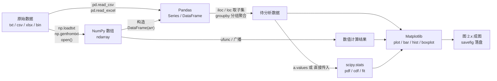

> **原书范围** 第 2 章（印刷页 39–84）

> 原书 p.39 章首语：本章依次介绍 Python 数值计算的基础库 NumPy、文件操作、数据处理的工具库 Pandas、主要可视化工具库 Matplotlib 和 scipy.stats 统计模块。

## 2.0 先把五个库串成一条数据流

教材按库分节讲，容易学成"五个互不相干的工具箱"。实际做一道建模题，五个库是**流水线上的五道工序**：



这条流水线在本批反复出现，按下表对照到具体例题：

| 流水线环节 | 载体 | 本批实例 |
| --- | --- | --- |
| 读入 | `loadtxt` / `genfromtxt` / `read_csv` / `read_excel` | 例 2.18–2.21、2.32–2.35、2.45 |
| 整理 | 索引切片、布尔索引、`reshape`、`iloc/loc`、`groupby` | 例 2.6–2.13、2.35、2.45 |
| 计算 | ufunc、广播、`describe`、`np.sum`、`scipy.stats` | 例 2.14–2.17、2.33、2.36 |
| 呈现 | `plot/bar/scatter/hist/boxplot/contour/plot_surface` | 例 2.36–2.45 |
| 落盘 | `savetxt` / `savez` / `savefig` / `to_excel` | 例 2.18、2.23、2.36、2.34 |

> **一个反复出现的坑**
> **类型在读入那一刻就定了。** 例 2.19 的 `loadtxt` 默认返回浮点；例 2.20 因混有姓名必须 `dtype=str`；例 2.21 第 9 列带单位 `60kg`，必须 `dtype=str` 再手工剥离单位。类型没定好，后面所有运算都会带着错误往前跑。

---

## 2.1 数值计算工具 NumPy

（原书 p.39）

教材开篇点明动机：列表 `list` 虽可做数组操作，但数据量大时**速度很慢**，故用 NumPy 扩展库；SciPy、Pandas、Matplotlib 都依赖它。NumPy 提供两类基本对象：

- **`ndarray`**（n-dimensional array object）：存储**单一数据类型**的多维数组，下文统称"数组"；
- **`ufunc`**（universal function object）：能对数组元素逐个处理的通用函数。

### 2.1.1 数组的创建、属性和操作

（原书 p.39–45）

`array` 函数传一个列表/元组 → 一维数组；传多个嵌套列表/元组 → 二维数组。**构成数组的元素必须同类型**。

#### 1. 数组的创建

**例 2.1（原书 p.39）** 用 `array` 创建数组。

```python
# 程序文件 Pex2_1.py
import numpy as np                    # 导入模块并命名为 np
a = np.array([2,4,8,20,16,30])        # 单个列表创建一维数组
# 嵌套元组创建二维数组
b = np.array(((1,2,3,4,5),(6,7,8,9,10),
              (10,9,1,2,3),(4,5,6,8,9.0)))
print("一维数组: ",a)
print("二维数组: \n",b)
```

运行结果（原书 p.40）：

```
一维数组:  [ 2  4  8 20 16 30]
二维数组:
[[ 1.  2.  3.  4.  5.]
 [ 6.  7.  8.  9. 10.]
 [10.  9.  1.  2.  3.]
 [ 4.  5.  6.  8.  9.]]
```

**原书据此得出的结论**：列表或元组可转成数组；第二个数组 `b` 输入元素含整型和浮点型两种类型，输出却统一为浮点型。

> **补充：为什么 `b` 会变成浮点**
> 放大 p.39 的原页可见，`b` 最后一个元组写的是 `(4,5,6,8,9.0)`——那个 **`9.0` 是浮点字面量**。只要有一个元素是 `float`，`ndarray` 就把整块提升为 `float64`（`b.dtype` 实测为 `float64`）。这正好解释了原书"输出统一为浮点型"那句话的机制。若写成 `9`，`dtype` 就是 `int64`，输出也不带小数点。

**例 2.2（原书 p.40）** `arange`、`empty`、`linspace` 等生成数组。

```python
# 程序文件 Pex2_2.py
import numpy as np
a=np.arange(4,dtype=float)          # 创建浮点型数组: [0., 1., 2., 3.]
b=np.arange(0,10,2,dtype=int)       # 创建整型数组: [0, 2, 4, 6, 8]
c=np.empty((2,3),int)               # 创建 2×3 的整型空矩阵
d=np.linspace(-1,2,5)               # 创建数组: [-1., -0.25, 0.5, 1.25, 2.]
e=np.random.randint(0,3,(2,3))      # 生成 [0,3) 上的 2 行 3 列的随机整数数组
```

> **注 2.1（原书 p.40）**
> 上面程序运行后**没有输出**，想看结果需自行加 `print`。后续程序对一些不重要的中间结果也不再输出，或者用 Anaconda 在 Spyder 控制台下直接看结果。
>
> 另外，`empty` 只分配内存、**不做初始化**，因此速度最快；`np.empty((2,3),int)` 的返回值是随机的，每次运行都不一样。

**例 2.3（原书 p.40）** 用虚数单位 `j` 生成数组。

```python
# 程序文件 Pex2_3.py
import numpy as np
a=np.linspace(0,2,5)          # 生成数组: [0., 0.5, 1., 1.5, 2.]
b=np.mgrid[0:2:5j]            # 等价于 np.linspace(0,2,5)
x,y=np.mgrid[0:2:4j,10:20:5j] # 生成 [0,2]×[10,20] 上的 4×5 的二维数组
print("x={}\ny={}".format(x,y))
```

> **补充：`mgrid` 的 `5j` 是"个数"不是"步长"**
> `0:2:5j` 表示在 `[0,2]` 上取 **5 个等距点**（复数的虚部当"点数"用），这一点和 `arange` 的第三参数（步长）语义完全不同，是本节最易错处。实测 `np.mgrid[0:2:4j,10:20:5j]` 返回两个 4×5 数组，`x` 每列相同（0, 0.667, 1.333, 2），`y` 每行相同（10, 12.5, 15, 17.5, 20）。

#### 2. 数组的属性

**表 2.1 数组的属性及说明（原书 p.41）**

| 属性 | 说明 |
| --- | --- |
| `ndim` | 返回 `int`，表示数组的维数 |
| `shape` | 返回元组，表示数组的尺寸，对于 $m$ 行 $n$ 列的矩阵，返回值为 $(m,n)$ |
| `size` | 返回 `int`，表示数组的元素总数，等于 `shape` 返回元组中所有元素的乘积 |
| `dtype` | 返回数据类型 |
| `itemsize` | 返回 `int`，表示数组每个元素的大小（以字节为单位） |

**例 2.4（原书 p.40–41）** 生成 $3\times5$ 的 $[1,10]$ 上取值的随机整数矩阵并显示属性。

```python
# 程序文件 Pex2_4.py
import numpy as np
a=np.random.randint(1,11,(3,5))
# 生成 [1,10] 区间上 3 行 5 列的随机整数数组
print("维数: ",a.ndim);        # 维数: 2
print("维度: ",a.shape)        # 维度: (3, 5)
print("元素总数: ",a.size);     # 元素总数: 15
print("类型: ",a.dtype)        # 类型: int32
print("每个元素字节数: ",a.itemsize)  # 字节数: 4
```

> **补充：`int32` 是平台相关的**
> 原书在 32 位 Windows 上得到 `int32`。在 64 位 Linux/macOS 或 Windows 上，`np.random.randint` 的默认整型通常是 `int32`（Windows）或 `int64`（Linux/macOS），`itemsize` 相应为 4 或 8。**这不是印刷错误，是可移植性差异**，报告时不要照抄。

**例 2.5（原书 p.41）** 生成数学上一维向量的三种模式。

```python
# 程序文件 Pex2_5.py
import numpy as np
a=np.array([1,2,3])
print("维度为: ",a.shape)     # 维度为: (3,)
b=np.array([[1,2,3]])
print("维度为: ",b.shape)     # 维度为: (1,3)
c=np.array([[1],[2],[3]])
print("维度为: ",c.shape)     # 维度为: (3,1)
```

> **注 2.2（原书 p.41）**
> 形状为 $(1,n)$、$(n,1)$、$(n,)$ 的 array 数组意义是不同的；形状为 $(n,)$ 的一维数组**既可以看成行向量，又可以看成列向量，它的转置不变**。这正是后续广播（2.1.2 节第 4 点）与矩阵乘法必须区分三者的原因。

#### 3. 数组元素的索引

（原书 p.41–43）

原书先划清界限：`list` 元素可不同类型，`array` 只允许同一类型。切片规则与列表相同（`start:end:step`，**不含 end**）；二维数组列表用 `a[i][j]`，数组用 `a[i,j]`。除整数与切片外，数组还支持**布尔索引**与**花式索引**。

**例 2.6（原书 p.42）** 一般索引。

```python
# 程序文件 Pex2_6.py
import numpy as np
a = np.array([2,4,8,20,16,30])
b = np.array(((1,2,3,4,5),(6,7,8,9,10),
              (10,9,1,2,3),(4,5,6,8,9.0)))
print(a[[2,3,5]])        # 一维数组索引，输出: [ 8 20 30]
print(a[[-1,-2,-3]])     # 一维数组索引，输出: [30 16 20]
print(b[1,2])            # 输出第2行第3列元素: 8.0
print(b[2])              # 输出第3行元素: [10.  9.  1.  2.  3.]
print(b[2,:])            # 输出第3行元素: [10.  9.  1.  2.  3.]
print(b[:,1])            # 输出第2列所有元素: [ 2.  7.  9.  5.]
print(b[[2,3],1:4])      # 输出第3、4行，第2、3、4列的元素
print(b[1:3,1:3])        # 输出第2、3行，第2、3列的元素
```

原书随后归纳的三条规则（p.42）值得背下来：

1. 一维数组索引中，可把任意位置的索引**组装为列表**，用作对应元素的获取；
2. 二维数组中位置索引必须写成 `[rows,cols]`，方括号前半部分控制**行**、后半部分控制**列**；
3. 若要取所有行或所有列，对应位置需用**英文状态的冒号**。

> **补充：`b[[2,3],1:4]` 是"行列表 + 切片"的混合，结果为 $2\times3$（取第 3、4 行，第 2–4 列）；它与 `b[1:3,1:3]`（切片+切片，$2\times2$）的区别在于前者每次取行是"复制"，后者仍是"视图"。写赋值语句时要特别小心这一点。**

**例 2.7（原书 p.42）** 布尔索引。

```python
# 程序文件 Pex2_7.py
from numpy import array, nan, isnan
a=array([[1, nan, 2], [4, nan, 3]])
b=a[~isnan(a)]        # 提取 a 中非 NaN 的数
print("b=",b)
print("b 中大于 2 的元素有: ", b[b>2])
```

运行结果：

```
b= [1. 2. 4. 3.]
b 中大于 2 的元素有:  [4. 3.]
```

> **这四行是"数据清洗"的原子操作**
> `~isnan(a)` 得到一个同形布尔数组，用它做索引即"按条件抽取"。实测注意两点：布尔索引的结果**总是一维**（展平），且**丢失原始行列位置**；若要保持二维形状，应改用 `np.where(a>2)` 或 `np.where(cond, x, y)`。

**例 2.8（原书 p.43）** 花式索引。索引值是**一个数组**：若索引数据是一维数组，结果是"对应位置的元素"（一维情形）或"对应下标的行"（二维情形）；当索引值为两个维度相同的二维数组时，以两个维度作横纵坐标取出单值后**组合成新的一维数组**。

```python
# 程序文件 Pex2_8.py
from numpy import array
x = array([[1,2],[3,4],[5,6]])
print("前两行元素为: \n", x[[0,1]])            # 输出: [[1,2],[3,4]]
print("x[0][0]和x[1][1]为: ", x[[0,1],[0,1]])  # 输出: [1 4]
print("以下两种格式是一样的: ")
print(x[[0,1]][:,[0,1]])   # 输出: [[1,2],[3,4]]
print(x[0:2,0:2])          # 同上，输出第1、2行，第1、2列的元素
```

> **`x[[0,1],[0,1]]` 与 `x[[0,1]][:,[0,1]]` 结果不同**
> 前者是**成对**取元素：取 $(0,0)$ 和 $(1,1)$，得 `[1 4]`；后者是**先取行再取列**的笛卡尔积，得 $2\times2$ 块。这是花式索引最容易混淆的一对写法，原书用"以下两种格式是一样的"作对照，其实对比的是后两行（都是 $2\times2$ 块）。

#### 4. 数组的修改

（原书 p.43）"修改"包括元素修改与维数扩大/缩小。

**例 2.9（原书 p.43）** 数组修改。

```python
# 程序文件 Pex2_9.py
import numpy as np
x = np.array([[1,2],[3,4],[5,6]])
x[2,0] = -1                 # 修改第3行、第1列元素为-1
y=np.delete(x,2,axis=0)     # 删除数组的第3行
z=np.delete(y,0,axis=1)     # 删除数组的第1列
t1=np.append(x,[[7,8]],axis=0)          # 增加一行
t2=np.append(x,[[9],[10],[11]],axis=1)  # 增加一列
```

实测结果（补充核对）：`x = [[1,2],[3,4],[-1,6]]`；`y = [[1,2],[3,4]]`；`z = [[2],[4]]`；`t1` 为 $4\times2$；`t2` 为 $3\times3$。

> **补充：`delete/append` 都返回**新数组****
> 它们不改变原数组（`x` 仍是"被改过 -1"的三行矩阵）。要就地删改应使用切片赋值或 `np.resize`；反复 `append` 在循环里会导致 $O(n^2)$ 复制，建模时应先预分配（如 `np.empty`）再填值。

#### 5. 数组的变形

（原书 p.43–45）`reshape` 改变数组维度，参数为正整数元组，分别指定各维度大小；**改变形状的同时不改变原始数据**；若指定维度与元素数目不符则抛出异常。

**表 2.2 数组变形和转换（假设数组为 `a`、`b`，相关操作维度是兼容的）（原书 p.44）**

| 函数 | 功能 | 调用方式 |
| --- | --- | --- |
| `reshape` | 改变数组的维度 | `a.reshape(m,n,s)` 把 `a` 变成 $m$ 个 $n$ 行 $s$ 列的数组，返回的是**视图**，`a` 本身不变 |
| `resize` | 改变数组的维度 | `a.resize(m,n,s)` 把 `a` 变成 …, **没有返回**，改变的是 `a` |
| `c_` | 列组合 | `c_[a,b]`，构造分块数组 $[a,b]$ |
| `r_` | 行组合 | `r_[a,b]`，构造分块数组 $\begin{bmatrix}a\\b\end{bmatrix}$ |
| `ravel` | 水平展开数组 | `a.ravel()` 返回的是 `a` 的视图 |
| `flatten` | 水平展开数组 | `a.flatten()` 返回的是真实数组，需要分配新的内存空间 |
| `hstack` | 数组横向组合 | `hstack((a,b))`，输入参数为元组 `(a,b)` |
| `vstack` | 数组纵向组合 | `vstack((a,b))` |
| `concatenate` | 数组横向或纵向组合 | `concatenate((a,b),axis=1)` 同 `hstack`；`concatenate((a,b),axis=0)` 同 `vstack` |
| `dstack` | 深度组合，如在一幅图像数据的二维数组上组合另一幅图像数据 | `dstack((a,b))` |
| `hsplit` | 数组横向分割 | `hsplit(a,n)` 把 `a` 平均分成 $n$ 个列数组 |
| `vsplit` | 数组纵向分割 | `vsplit(a,m)` 把 `a` 平均分成 $m$ 个行数组 |
| `split` | 数组横向或纵向分割 | `split(a,n,axis=1)` 同 `hsplit(a,n)`；`split(a,n,axis=0)` 同 `vsplit(a,n)` |
| `dsplit` | 沿深度方向分割数组 | `dsplit(a,n)` 沿深度方向平均分成 $n$ 个数组 |
| `tolist` | 把数组转换成 Python 列表 | `a.tolist()` |

**例 2.10（原书 p.43–44）** `reshape` 与 `resize` 变形。

```python
# 程序文件 Pex2_10.py
import numpy as np
a=np.arange(4).reshape(2,2)   # 生成数组[[0,1],[2,3]]
b=np.arange(4).reshape(2,2)   # 生成数组[[0,1],[2,3]]
print(a.reshape(4,),'\n',a)   # 输出: [0 1 2 3]和[[0,1],[2,3]]
print(b.resize(4,),'\n',b)    # 输出: None和[0 1 2 3]
```

原书结论（p.44）：`reshape` 只返回改变形状后的**视图**，数组本身不变；`resize` **没有返回**，直接改变数组本身。

**例 2.11（原书 p.44–45）** 数组降维，三种方法均可实现。

```python
# 程序文件 Pex2_11.py
import numpy as np
a=np.arange(4).reshape(2,2)
b=np.arange(4).reshape(2,2)
c=np.arange(4).reshape(2,2)
print(a.reshape(-1),'\n',a)   # 输出: [0 1 2 3]和[[0,1],[2,3]]
print(b.ravel(),'\n',b)       # 输出: [0 1 2 3]和[[0,1],[2,3]]
print(c.flatten(),'\n',c)     # 输出: [0 1 2 3]和[[0,1],[2,3]]
```

原书比较（p.45）：三种方法显示效果一样，原数组都没被修改；但平时使用 `flatten()` 比较合适，因为它分配了新内存；`ravel()` 返回的是**视图**，`e = b.ravel()` 是允许的（改 `e` 会改 `b`）。

**例 2.12（原书 p.45）** 数组组合。

```python
# 程序文件 Pex2_12.py
import numpy as np
a=np.arange(4).reshape(2,2)    # 生成数组[[0,1],[2,3]]
b=np.arange(4,8).reshape(2,2)  # 生成数组[[4,5],[6,7]]
c1=np.vstack([a,b])   # 垂直方向组合
c2=np.r_[a,b]         # 垂直方向组合
d1=np.hstack([a,b])   # 水平方向组合
d2=np.c_[a,b]         # 水平方向组合
```

**例 2.13（原书 p.45）** 数组分割。

```python
# 程序文件 Pex2_13.py
import numpy as np
a=np.arange(4).reshape(2,2)   # 构造 2 行 2 列的数组
b=np.hsplit(a,2)              # 把 a 平均分成 2 个列数组
c=np.vsplit(a,2)              # 把 a 平均分成 2 个行数组
print(b[0],'\n',b[1],'\n',c[0],'\n',c[1])
```

### 2.1.2 数组的运算、通用函数和广播运算

（原书 p.45–47）

#### 1. 四则运算

四则运算既可用运算符 `+ - * /`，也可用函数 `add, subtract, multiply, divide`。要点：**函数只能接受两个对象**，多对象需嵌套。

另有三个数学运算符：余数 `%`、整除 `//`、幂次 `**`，对应函数 `fmod, modf, power`。其中整除需写成 `np.modf(a/b)[1]`，因为 `modf` 返回"小数部分 + 整数部分"两个值。

**例 2.14（原书 p.45–46）** 数组简单运算。

```python
# 程序文件 Pex2_14.py
import numpy as np
a=np.arange(10,15); b=np.arange(5,10)
c=a+b; d=a*b                # 对应元素相加和相乘
e1=np.modf(a/b)[0]          # 对应元素相除的小数部分
e2=np.modf(a/b)[1]          # 对应元素相除的整数部分
```

> **补充：`//` 与 `modf` 不等价**
> `a//b` 是地板除（向下取整），`np.modf(a/b)[1]` 是**截断**向零取整，负数时结果不同。原书用 `modf` 讲整除，教学上是为了演示"一个函数返回两个数组"，工程上应直接用 `a//b`。

#### 2. 比较运算

**表 2.3 比较运算符及其含义（原书 p.46）**

| 符号 | 函数 | 含义 |
| --- | --- | --- |
| `>` | `greater(a,b)` | 判断 a 的元素是否大于 b 的元素 |
| `>=` | `greater_equal(a,b)` | 判断 a 的元素是否大于等于 b 的元素 |
| `<` | `less(a,b)` | 判断 a 的元素是否小于 b 的元素 |
| `<=` | `less_equal(a,b)` | 判断 a 的元素是否小于等于 b 的元素 |
| `==` | `equal(a,b)` | 判断 a 的元素是否等于 b 的元素 |
| `!=` | `not_equal(a,b)` | 判断 a 的元素是否不等于 b 的元素 |

比较运算返回 **`bool` 类型**（`True`/`False`）。

**例 2.15（原书 p.46）** 比较运算。

```python
# 程序文件 Pex2_15.py
import numpy as np
a=np.array([[3,4,9],[12,15,1]])
b=np.array([[2,6,3],[7,8,12]])
print(a[a>b])                  # 取出 a 大于 b 的所有元素，输出: [ 3  9 12 15]
print(a[a>10])                 # 取出 a 大于 10 的所有元素，输出: [12 15]
print(np.where(a>10,-1,a))     # a 中大于 10 的元素改为-1
print(np.where(a>10,-1,0))     # a 中大于 10 的元素改为-1，否则为 0
```

最后一个 `print` 输出：

```
[[ 0  0  0]
 [-1 -1  0]]
```

原书结论（p.46）：多维数组通过 `bool` 索引返回的都是**一维数组**；`np.where` 返回的数组**保持原来的形状**。

#### 3. ufunc 函数

`ufunc` 全称通用函数，对数组元素**逐个**操作，且都以 NumPy 数组为输出。用 ufunc 比 `math` 库函数**效率高很多**；目前支持超过 60 种，涵盖四则运算、求模、取绝对值、幂函数、指数函数、三角函数、位运算、比较运算和逻辑运算等。

**例 2.16（原书 p.47）** ufunc 效率对比。

```python
# 程序文件 Pex2_16.py
import numpy as np, time, math
x=[i*0.01 for i in range(1000000)]
start=time.time()   # 1970纪元后经过的浮点秒数
for (i,t) in enumerate(x): x[i]=math.sin(t)
print("math.sin:", time.time()-start)
y=np.array([i*0.01 for i in range(1000000)])
start=time.time()
y=np.sin(y)
print("numpy.sin:", time.time()-start)
```

原书运行结果（p.47）：`math.sin: 0.3449997901916504`，`numpy.sin: 0.010999917984008789`——数组操作的整体耗时比 `math` 模块函数少得多。

> **验证状态**
> 这两个具体秒数与机器性能强相关，**不可复现也不必复现**；可复现的是**量级差**（约 10–30 倍）。若在本机重跑，应报告"加速比"而非照抄原书数字。

#### 4. ufunc 函数的广播机制

**广播（broadcasting）** 指不同形状的数组之间执行算术运算的方式。前提是两数组维度**兼容**，不兼容时 NumPy 尝试广播；广播有规则，不满足就报错。

**广播规则（原书 p.47）**：

1. 各输入数组的维度可以不相等，但**必须确保从右到左的对应维度值相等**；
2. 如果对应维度值不相等，就**必须保证其中一个为 1**。

**例 2.17（原书 p.47）** 广播机制。

```python
# 程序文件 Pex2_17.py
import numpy as np
a=np.arange(0, 20, 10).reshape(-1, 1)
        # 变形为1列的数组，行数自动计算
b=np.arange(0, 3)
print(a+b)
```

运行结果：

```
[[ 0  1  2]
 [10 11 12]]
```

> **形状对齐试算**
> `a` 是 $(2,1)$，`b` 是 $(3,)$；从右到左比：$1$ 与 $3$ → 有一者为 1，可广播成 3；再看左侧：$2$ 与"无" → 缺的当作 1，可广播成 2。结果 $(2,3)$。**这条"从右往左、缺当 1、有 1 可伸"的口诀，比记规则条文好用。**

### 2.1.3 NumPy.random 模块的随机数生成

（原书 p.48）内置 `random` 一次只能生成一个随机数且种类不足；`NumPy.random` 可生成**随机向量**且函数丰富。

**表 2.4 常见随机数生成函数（原书 p.48，节选常用者）**

| 函数 | 说明 |
| --- | --- |
| `seed(n)` | 设置随机数种子 |
| `beta(a,b,size=None)` | 生成 Beta 分布随机数 |
| `chisquare(df,size=None)` | 生成自由度为 `df` 的 $\chi^2$ 分布随机数 |
| `choice(a,size=None,replace=None,p=None)` | 从 `a` 中有放回地随机挑选指定数量的样本 |
| `exponential(scale=1.0,size=None)` | 生成指数分布随机数 |
| `f(dfnum,dfden,size=None)` | 生成 $F$ 分布随机数 |
| `gamma(shape,scale=1.0,size=None)` | 生成伽马分布随机数 |
| `geometric(p,size=None)` | 生成几何分布随机数 |
| `hypergeometric(ngood,nbad,nsample,size=None)` | 生成超几何分布随机数 |
| `laplace(loc=0.0,scale=1.0,size=None)` | 生成 Laplace 分布随机数 |
| `logistic(loc=0.0,scale=1.0,size=None)` | 生成 Logistic 分布随机数 |
| `lognormal(mean=0.0,sigma=1.0,size=None)` | 生成对数正态分布随机数 |
| `negative_binomial(n,p,size=None)` | 生成负二项分布随机数 |
| `multinomial(n,pvals,size=None)` | 生成多项分布随机数 |
| `multivariate_normal(mean,cov[,size])` | 生成多元正态分布随机数 |
| `normal(loc=0.0,scale=1.0,size=None)` | 生成正态分布随机数 |
| `pareto(a,size=None)` | 生成帕累托分布随机数 |
| `poisson(lam=1.0,size=None)` | 生成泊松分布随机数 |
| `rand(d0,d1,…,dn)` | 生成 $n+1$ 维的 $[0,1)$ 上均匀分布随机数 |
| `randn(d0,d1,…,dn)` | 生成 $n+1$ 维的标准正态分布随机数 |
| `randint(low,high=None,size=None,dtype='l')` | 生成区间 `[low,high)` 上的随机整数 |
| `random_sample(size=None)` | 生成 $[0,1)$ 上的随机数 |
| `standard_t(df,size=None)` | 生成标准的 $t$ 分布随机数 |
| `uniform(low=0.0,high=1.0,size=None)` | 生成区间 `[low,high)` 上均匀分布随机数 |
| `wald(mean,scale,size=None)` | 生成 Wald 分布随机数 |
| `weibull(a,size=None)` | 生成 Weibull 分布随机数 |

> **补充：新版 NumPy 的写法**
> NumPy ≥1.17 推荐 `rng = np.random.default_rng(seed)`，再用 `rng.normal(...)`、`rng.integers(...)`（注意 `integers` 取代 `randint`）。旧 API 仍可用但不再演进。**复现实验务必先 `seed`**，否则"结果对不上"往往只是没固定种子。

### 2.1.4 文本文件和二进制文件存取

（原书 p.48–52）NumPy 的文件操作函数便于存取数组内容，格式分两类：**二进制**与**文本**；二进制又分 NumPy 专用格式和无格式类型。

#### 1. 文本文件的存取

**1) `savetxt()` 和 `loadtxt()`**

`savetxt()` 可把 1 维和 2 维数组保存到文本文件；`loadtxt()` 可把文本文件中的数据加载到 1 维和 2 维数组。

**例 2.18（原书 p.49）** 文本文件存取。

```python
# 程序文件 Pex2_18.py
import numpy as np
a=np.arange(0,3,0.5).reshape(2,3)   # 生成 2×3 的数组
np.savetxt("Pdata2_18_1.txt", a)
        # 缺省按照'%.18e'格式保存数值，以空格分隔
b=np.loadtxt("Pdata2_18_1.txt")     # 返回浮点型数组
print("b=",b)
np.savetxt("Pdata2_18_2.txt", a, fmt="%d", delimiter=",")
        # 保存为整型数据，以逗号分隔
c=np.loadtxt("Pdata2_18_2.txt", delimiter=",")
        # 读入的时候也需要指定逗号分隔
print("c=",c)
```

运行结果：

```
b= [[0.  0.5 1. ]
 [1.5 2.  2.5]]
c= [[0. 0. 1.]
 [1. 2. 2.]]
```

> **`fmt="%d"` 会**截断**而不是四舍五入**
> $0.5$ 存成 `0`、$2.5$ 存成 `2`、$1.5$ 存成 `1`——原书结果 `c=[[0,0,1],[1,2,2]]` 正是截断的效果。若需要四舍五入，应写 `fmt="%.0f"`。**这是把浮点数据落盘成整数时最常见的静默错误。**

**例 2.19（原书 p.49–50）** 文本文件 `Pdata2_19.txt` 中存放如下格式的数据：

```
6 2 6 7 4 2 5 9
4 9 5 3 8 5 8 2
5 2 1 9 7 4 3 3
7 6 7 3 9 2 7 1
2 3 9 5 7 2 6 5
5 5 2 2 8 1 4 3
```

把其中的数据读入数组 `a`，并提取 `a` 的前 2 行、第 2 列到第 4 列的元素，构造一个 2 行 3 列的数组 `b`。

```python
# 程序文件 Pex2_19.py
import numpy as np
a=np.loadtxt("Pdata2_19.txt")   # 返回值 a 为浮点型数据
b=a[0:2,1:4]                    # 获取 a 的第 1,2 行，第 2,3,4 列
print("b=",b)
```

程序运行结果（原书 p.50）：

```
b= [[2. 6. 7.]
 [9. 5. 3.]]
```

**例 2.20（原书 p.50）** 文本文件 `Pdata2_20.txt` 中存放如下格式的数据：

```
姓名, 年龄, 体重, 身高
张三,   30,   75,   165
李四,   45,   60,   179
王五,   15,   39,   120
```

提取其中的数值数据。

```python
# 程序文件 Pex2_20.py
import numpy as np
a=np.loadtxt("Pdata2_20.txt",dtype=str,delimiter=", ")
b=a[1:,1:].astype(float)   # 提取 a 矩阵的数值行和数值列，并转换类型
print("b=",b)
```

运行结果：

```
b= [[ 30.  75. 165.]
 [ 45.  60. 179.]
 [ 15.  39. 120.]]
```

> **补充：`delimiter=", "` 带空格**
> 原书写的是 `delimiter=", "`（逗号+空格），与文件里"逗号后跟空格"的排版一致。若实际文件是纯逗号分隔，必须写 `delimiter=","`，否则整行会被当成一个字段。**遇到"读进来只有一列"，先怀疑分隔符。**

若需处理更复杂的数据结构（如缺失数据），应改用 `genfromtxt`。

**2) `genfromtxt` 读入文本文件数据**

调用格式（原书 p.50）：

```python
genfromtxt(fname, dtype=<class 'float'>, comments='#',
    delimiter=None, skip_header=0, skip_footer=0, converters=None,
    missing_values=None, filling_values=None, usecols=None, names=None,
    excludelist=None, deletechars=None, replace_space='_',
    autostrip=False, case_sensitive=True, defaultfmt='f%i', unpack=None,
    usemask=False, loose=True, invalid_raise=True, max_rows=None,
    encoding='bytes')
```

常用参数（原书 p.51，逐条整理）：

| 参数 | 含义 |
| --- | --- |
| `fname` | 指定需要读入数据的文件名 |
| `dtype` | 指定读入数据的数据类型，默认为浮点型；如果原数据集合中有字符型数据，**必须指定为 `"str"`** |
| `comments` | 指定注释符，默认 `"#"`；若原数据行首有 `#`，将忽略这些行 |
| `delimiter` | 指定数据集的列分隔符 |
| `skip_header` | 是否跳过数据集的首行，默认不跳过 |
| `skip_footer` | 是否跳过数据集的脚注，默认不跳过 |
| `converters` | 将指定列的数据转换成其他数值 |
| `missing_values` | 指定缺失值的标记；含该标记的数据读入后即为缺失值 |
| `filling_values` | 指定缺失值的填充值 |
| `usecols` | 指定需要读入的列 |
| `names` | 为读入数据的列设置列名称 |
| `encoding` | 若文件含中文，有时需指定字符编码 |

**例 2.21（原书 p.51）** 纯文本文件 `Pdata2_21.txt` 中存放如下数据，分别读取其中的前 6 行前 8 列数据、第 9 列的数值数据、最后一行数据。

```
6 2 6 7 4 2 5 9   60kg
4 9 5 3 8 5 8 2   55kg
5 2 1 9 7 4 3 3   51kg
7 6 7 3 9 2 7 1   43kg
2 3 9 5 7 2 6 5   41kg
5 5 2 2 8 1 4 -999 52kg
35 37 22 32 41 32 43 38
```

```python
# 程序文件 Pex2_21.py
import numpy as np
# 读前 6 行前 8 列数据
a=np.genfromtxt("Pdata2_21.txt",max_rows=6, usecols=range(8))
b=np.genfromtxt("Pdata2_21.txt",dtype=str,max_rows=6,usecols=[8])
                                # 读第 9 列数值数据
b=[float(v.rstrip('kg')) for (i,v) in enumerate(b)]
                                # 删除 kg，并转换为浮点型数据
c=np.genfromtxt("Pdata2_21.txt",skip_header=6)  # 读最后一行数据
print(a,'\n',b,'\n',c)
```

> **这一例其实是"读脏数据"的标准套路**
> 三处细节值得记住：① `usecols=range(8)` 只取前 8 列，规避带单位的第 9 列；② 第 9 列用 `dtype=str` 读成字符串，再用 `rstrip('kg')` 剥单位、`float` 转数；③ 第 6 行第 9 位是 `-999`——**这是缺失值占位符**，正是 `genfromtxt` 的 `missing_values` 参数存在的理由（本例用切片绕开了它，但真实数据必须显式处理，否则 $-999$ 会污染均值）。
> 原书未打印本例输出；按程序逻辑，`a` 为 $6\times8$ 浮点阵，`b` 为 6 个重量值 `[60.0, 55.0, 51.0, 43.0, 41.0, 52.0]`，`c` 为最后一行的 8 个合计值。

#### 2. 二进制格式文件存取

**1) `tofile()` 和 `fromfile()`**

`tofile()` 把数组以二进制格式写入文件，**不保存数组形状和元素类型**；`fromfile()` 读回时需用户指定元素类型，并对形状做适当修改。

**例 2.22（原书 p.52）**

```python
# 程序文件 Pex2_22.py
import numpy as np
a=np.arange(6).reshape(2,3)
a.tofile('Pdata2_22.bin')
b=np.fromfile('Pdata2_22.bin',dtype=int).reshape(2,3)
print(b)
```

**2) `load()`、`save()` 和 `savez()`**

`load()`/`save()` 用 NumPy **专用**二进制格式，自动处理元素类型与形状。若要把多个数组存到一个文件，用 `savez()`：第一参数为文件名，其后为待保存的数组，输出扩展名为 `npz` 的压缩文件。

**例 2.23（原书 p.52）**

```python
# 程序文件 Pex2_23.py
import numpy as np
a=np.arange(6).reshape(2,3)
np.save("Pdata2_23_1.npy",a)
b=np.load("Pdata2_23_1.npy")
c=np.arange(6,12).reshape(2,3)
d=np.sin(c)
np.savez("Pdata2_23_2.npz",c,d)
e=np.load("Pdata2_23_2.npz")
f1=e["arr_0"]   # 提取第一个数组的数据
f2=e["arr_1"]   # 提取第二个数组的数据
```

原书说明（p.52）：用解压软件打开 `Pdata2_23_2.npz`，会发现其中有两个文件 `arr_0.npy`、`arr_1.npy`，分别保存 `c`、`d`；`load()` 自动识别 npz 文件并返回**类似字典**的对象，可通过数组名作键获取内容。

> **补充：三种二进制格式怎么选**
> `tofile` 无自描述 → 跨程序交换方便（纯裸数据），但读回必须自己知道 dtype 与形状；`save/load`（`.npy`）自描述单数组，最常用；`savez`（`.npz`）自描述多数组，适合"一次落盘一组中间结果"。**建模工程里优先 `.npz`，因为它记形状、记类型、且一次 IO 拿全部对象。**

---

## 2.2 文件操作

（原书 p.53）按数据组织形式分**文本文件**（每字节存一个 ASCII 码，代表一个字符）与**二进制文件**（内存中的存储形式原样输出到磁盘）。实际应用中文件操作经常碰到：本章关心的是"如何读写、如何管理"。

### 2.2.1 文件基本操作

#### 1. 打开文件

流程统一：**打开文件并创建文件对象 → 读/写/删/改 → 关闭并保存**。内置 `open()` 按指定模式打开并创建对象：

```python
文件对象名 = open(文件名[, 打开方式[, 缓冲区]])
```

- **文件名**：不在当前目录需写完整路径。路径中的 `\` 要写成 `\\`，例如打开 `e:\mypython\test.txt` 要写成 `"e:\\mypython\\test.txt"`。
- **打开方式**：见表 2.5。
- **缓冲区**：0 表示不缓冲，1 表示缓冲，大于 1 表示缓冲区大小，默认值是缓冲模式。
- 执行正常时 `open()` 返回 1 个文件对象；文件不存在、访问权限不够、磁盘空间不够等原因导致创建失败则**抛出异常**。

**表 2.5 文件操作方式（原书 p.53）**

| 打开方式 | 含义 | 打开方式 | 含义 |
| --- | --- | --- | --- |
| `r`(只读) | 为输入打开一个文本文件 | `r+`(读/写) | 为读/写打开一个文本文件 |
| `w`(只写) | 为输出建立一个新的文本文件 | `w+`(读/写) | 为读/写建立一个新的文本文件 |
| `a`(追加) | 向文本文件尾增加数据 | `a+`(读/写) | 为读/写打开一个文本文件 |
| `rb`(只读) | 为输入打开一个二进制文件 | `rb+`(读/写) | 为读/写打开一个二进制文件 |
| `wb`(只写) | 为输出建立一个新的二进制文件 | `wb+`(读/写) | 为读/写建立一个新的二进制文件 |
| `ab`(追加) | 向二进制文件尾增加数据 | `ab+`(读/写) | 为读/写打开一个二进制文件 |

#### 2. 文件对象属性

**表 2.6 文件对象常用属性（原书 p.54）**

| 属性 | 说明 |
| --- | --- |
| `closed` | 如果文件被关闭则返回 `True`，否则返回 `False` |
| `mode` | 返回该文件的打开方式 |
| `name` | 返回文件的名称 |

#### 3. 文件对象方法

**表 2.7 文件对象常用方法（原书 p.54）**

| 方法 | 功能说明 |
| --- | --- |
| `flush()` | 把缓冲区的内容写入文件，但不关闭文件 |
| `close()` | 把缓冲区的内容写入文件，同时关闭文件，并释放文件对象 |
| `read([size])` | 从文件中读取 `size` 个字符的内容作为结果返回，省略 `size` 则表示一次性读取所有内容 |
| `readline()` | 从文本文件中读取一行内容作为结果返回 |
| `readlines()` | 把文本文件中的所有内容作为一个字符串存入列表中，返回该列表 |
| `seek(offset[,where])` | 把文件指针移动到相对于 `where` 的 `offset` 位置；`where` 为 0 表示文件开始处（默认值），1 表示当前位置，2 表示文件尾 |
| `tell()` | 返回文件指针的当前位置 |
| `truncate()` | 删除从当前指针位置到文件末尾的内容。如果指定了 `size`，则不论指针在什么位置都只留下前 `size` 个字节，其余的删除 |
| `write(s)` | 把字符串 `s` 的内容写入文件（文本文件或二进制文件） |
| `write(list)` | 把 `list` 列表中的字符串写入文本文件，不添加换行符 |
| `next()` | 返回文件的下一行，并将文件操作标记移到下一行 |

#### 4. 关闭文件

文件用完应关闭，以释放对象并避免数据丢失，调用格式为 `文件对象名.close()`。

**例 2.24（原书 p.54–55）** 文件对象属性操作。

```python
# 程序文件 Pex2_24.py
f=open("Pdata2_12.txt","w")
print("Name of the file:",f.name)
print("Closed or not:",f.closed)
print("Opening mode:",f.mode)
f.close()
```

程序运行结果（原书 p.55）：

```
Name of the file: Pdata2_12.txt
Closed or not: False
Opening mode: w
```

> **文件名的小疑点**
> 本例写的是 `Pdata2_12.txt`，而 2.1.4 节用到的数据文件名为 `Pdata2_18_*` 等。**这是原书的编号笔误（应为 `Pdata2_24.txt`）**，不影响讲解；照抄代码前建议改成 `Pdata2_24.txt`，否则会在当前目录悄悄建出一个与别处同名的文件。

### 2.2.2 文本文件的读写操作

（原书 p.55–56）

**例 2.25（原书 p.55）** 统计文本文件 `Pdata2_25.txt` 中元音字母出现的次数。文件内容（用记事本建立）：

```
Python is very useful.
Programming in Python is very easy.
```

```python
# 程序文件 Pex2_25.py
f=open("Pdata2_25.txt","r")
s=f.read()
print(s)      # 显示文件内容
n=0
for c in s:
    if c in "aeiouAEIOU": n+=1
print("元音的个数为: ",n)
```

运行结果：

```
Python is very useful.
Programming in Python is very easy.
元音的个数为:  15
```

**例 2.26（原书 p.55）** 向文本文件写入数据。

```python
# 程序文件 Pex2_26.py
f1=open("Pdata2_26.txt","w")
str1=['Hello,',' ','World!']; str2=['Hello','World!']
f1.writelines(str1); f1.write('\n')
f1.writelines(str2); f1.close()
f2=open('Pdata2_26.txt')
a=f2.read(); print(a)
```

运行结果：

```
Hello World!
HelloWorld!
```

> **`writelines` 不加分隔符**
> 第一个列表自身带空格元素 `' '`，输出才有空格；第二个列表没有，输出就连在一起。**`writelines` 不做任何拼接**，这是它与 `print(..., file=f)` 的关键差别。

**例 2.27（原书 p.56，续例 2.21）** 用 Python 原生文件对象重做例 2.21 的三段读取。

```python
# 程序文件 Pex2_27.py
import numpy as np
a = []; b = []; c = []
with open('Pdata2_21.txt') as file:
    for (i, line) in enumerate(file):
        elements = line.strip().split()
        if i < 6:
            a.append(list(map(float, elements[:8])))
            b.append(float(elements[-1].rstrip('kg')))
        else:
            c = [float(x) for x in elements]
a = np.array(a); b = np.array(b); c = np.array(c)
print(a,'\n',b,'\n',c)
```

> **注 2.3（原书 p.56）**
> 用 `with` 语句打开数据文件并把它绑定到对象 `file`，**不必操心在操作完资源后去关闭数据文件**。

### 2.2.3 文件管理方法

（原书 p.56–57）`os` 模块提供类似操作系统级的文件管理功能。

#### 1. 文件和目录列表

`listdir()` 返回指定目录下的文件和目录列表，一般格式 `os.listdir("目录名")`。

**例 2.28（原书 p.56）** 显示指定目录内容。

```python
# 程序文件 Pex2_28.py
import os
a=os.listdir("c:\\")
print(a)        # 显示 C 根目录下的文件和目录列表
print("----------------------------------------")
b=os.listdir(".")
print(b)        # 显示当前工作目录下的文件和目录列表
```

#### 2. 文件重命名

`os.rename("当前文件名","新文件名")`。例如把 `test1.txt` 重命名为 `test2.txt`：

```python
>>> import os
>>> os.rename("test1.txt","test2.txt")
```

#### 3. Python 中的目录操作

| 方法 | 格式 | 作用 |
| --- | --- | --- |
| `mkdir()` | `os.mkdir("新目录名")` | 在当前目录下创建目录 |
| `chdir()` | `os.chdir("要成为当前目录的目录名")` | 改变当前目录 |
| `getcwd()` | `os.getcwd()` | 显示当前工作目录 |
| `rmdir()` | `os.rmdir("待删除目录名")` | 删除**空**目录 |

原书提醒（p.57）：用 `rmdir()` 删除目录时，**先要删除目录中的所有内容，然后才能删除目录**。

---

## 2.3 数据处理工具 Pandas

（原书 p.57–64）Pandas（panel data，面板数据）在 NumPy 基础上开发，是 Python 最强大的数据分析与探索工具之一，作为金融数据分析工具而开发，支持类似 SQL 的模型、支持时间序列分析，可帮助分析师解决**数据预处理**问题（类型转换、缺失值处理、描述性统计分析、汇总等）。

查看库中函数：`>>> import pandas as pd` / `>>> dir(pd)`。最重要的是 `Series` 与 `DataFrame` 两个子类：`from pandas import Series, DataFrame`。

Pandas 可进行统计特征计算（均值、方差、分位数、相关系数、协方差等）：

- `mean()`：样本数据的算术平均值
- `std()`：样本数据的标准差
- `cov()`：样本数据的协方差矩阵
- `var()`：样本数据的方差
- `describe()`：描述样本数据的基本情况，包括非 NaN 数据个数、均值、标准差、最小值、最大值以及样本的 25%、50%、75% 分位数

### 2.3.1 Pandas 的序列与数据框

（原书 p.58–60）数据结构从一维到三维：`Series`（序列，一维）、`DataFrame`（数据框，二维）、`Panel`（三维及以上）。

- **Series**：带标签的一维数组，可存任意类型数据（整型、浮点型、字符串及其他有效 Python 对象），**行标签称 `index`**。
- **DataFrame**：带标签的二维数组，有行和列，列可有多种类型。可看作二维结构的数组（如电子表格、数据库表格），也可看作"包含多个不同类型的 Series 的集合"。
- **Panel**：统计学与经济学中的多维数据，含不同时间的不同测量结果；与 Series/DataFrame 相比**不太常用**。

#### 1. 序列

构造方式四种：① 同类型列表或元组；② 字典；③ NumPy 一维数组；④ 数据框中的某一列。

**例 2.29（原书 p.58–59）** 序列构建。

```python
# 程序文件 Pex2_29.py
import pandas as pd
import numpy as np
s1=pd.Series(np.array([10.5,20.5,30.5]))    # 由数组构造序列
s2=pd.Series({"北京":10.5,"上海":20.5,"广东":30.5})  # 由字典构造序列
s3= pd.Series([10.5,20.5,30.5],index=['b','c','d'])  # 给出行标签命名
print(s1); print("--------------"); print(s2)
print("--------------"); print(s3)
```

**表 2.8 序列 s1、s2 和 s3 的显示结果（原书 p.59）**

| s1 | | s2 | | s3 | |
| --- | --- | --- | --- | --- | --- |
| 0 | 10.5 | 北京 | 10.5 | b | 10.5 |
| 1 | 20.5 | 上海 | 20.5 | c | 20.5 |
| 2 | 30.5 | 广东 | 30.5 | d | 30.5 |
| `dtype: float64` | | `dtype: float64` | | `dtype: float64` | |

原书结论（p.59）：序列有**两列**构成——第一列是行索引（可理解为行号，从 0 开始），第二列是实际值；由字典构造时，第一列是具体行名（`index`，对应字典的键）。序列与一维数组**相似度极高**：获取一维数组元素的所有方法都可用于序列，数组的数学与统计函数也可用于序列对象；不同的是序列有更多其他处理方法。

**例 2.30（原书 p.59）** 序列索引和计算。

```python
# 程序文件 Pex2_30.py
import pandas as pd
import numpy as np
s=pd.Series([10.5,20.5,98],index=['a','b','c'])
a=s['b']        # 取出序列的第 2 个元素，输出: 20.5
b1=np.mean(s)   # 输出: 43.0
b2=s.mean()     # 通过数列方法求均值，输出: 43.0
```

> **补充：`np.mean(s)` 与 `s.mean()` 为何都给 43.0**
> $(10.5+20.5+98)/3=43.0$。`np.mean` 会先把 Series 转成数组再算；`s.mean()` 走 Pandas 自身实现，会自动**跳过 NaN**（`np.mean` 不会）。数据有缺失时两者结果不同，这是排查"均值对不上"的常见原因。

#### 2. 数据框

`DataFrame` 由行和列构成的二维数据结构。**索引和列名称是可选的，但最好设置**：索引可看成行标签，列名称可看成列标签。

```python
DataFrame(data=二维数据[, index=行索引][, columns=列索引][, dtype=数据类型])
```

其中 `data` 可为二维 NumPy 数组；若 `data` 是字典，其值为一维数组时，字典的**键为数据框的列名**。

**例 2.31（原书 p.60）** 构造数据框。

```python
# 程序文件 Pex2_31.py
import pandas as pd
import numpy as np
a=np.arange(1,7).reshape(3,2)
df1=pd.DataFrame(a)
df2=pd.DataFrame(a,index=['a','b','c'], columns=['x1','x2'])
df3=pd.DataFrame({'x1':a[:,0],'x2':a[:,1]})
print(df1); print("--------"); print(df2)
print("--------"); print(df3)
```

**表 2.9 数据框 df1、df2 和 df3 的显示结果（原书 p.60）**

| df1 | 0 | 1 | df2 | x1 | x2 | df3 | x1 | x2 |
| --- | --- | --- | --- | --- | --- | --- | --- | --- |
| 0 | 1 | 2 | a | 1 | 2 | 0 | 1 | 2 |
| 1 | 3 | 4 | b | 3 | 4 | 1 | 3 | 4 |
| 2 | 5 | 6 | c | 5 | 6 | 2 | 5 | 6 |

> **补充：`df3` 的列序可能与你预期不同**
> 字典在 Python 3.7+ 保序，所以 `df3` 得到 `x1, x2`；但在早期版本或某些构造路径下，列序按字典键排序，可能变成 `x2, x1`。**依赖列序的代码应显式写 `columns=[...]`。**

### 2.3.2 外部文件的存取

（原书 p.60–64）实际应用中更多是通过 Python 读取外部数据（文本文件如 csv/txt、电子表格 Excel）。

#### 1. 文本文件的读取

`read_csv` 可读取 txt 或 csv（逗号分隔的文本文件）。调用格式（原书 p.60–61，完整签名）：

```python
read_csv(filepath_or_buffer, sep=',', delimiter=None,
    header='infer', names=None, index_col=None, usecols=None,
    squeeze=False, prefix=None, mangle_dupe_cols=True, dtype=None,
    engine=None, converters=None, true_values=None, false_values=None,
    skipinitialspace=False, skiprows=None, skipfooter=0, nrows=None,
    na_values=None, keep_default_na=True, na_filter=True, verbose=False,
    skip_blank_lines=True, parse_dates=False, infer_datetime_format=False,
    keep_date_col=False, date_parser=None, dayfirst=False, iterator=False,
    chunksize=None, compression='infer', thousands=None, decimal='.',
    lineterminator=None, quotechar='"', quoting=0, doublequote=True,
    escapechar=None, comment=None, encoding=None, dialect=None,
    tupleize_cols=None, error_bad_lines=True, warn_bad_lines=True,
    delim_whitespace=False, low_memory=True, memory_map=False,
    float_precision=None)
```

重要参数（原书 p.61）：

1. **`filepath_or_buffer`**：可为 URL 和文件，URL 包括 http、ftp 等；
2. **`sep`**：不指定则尝试用逗号分隔；
3. **`delimiter`**：定界符，备选分隔符（指定该参数后 `sep` 失效）；
4. **`header`**：`header=None` 表明原始数据**没有列标题**，`read_csv` 会自动加上列标题；`header=0` 表示文件第一行为列标题（索引从 0 开始）；`header` 也可为列表如 `[0,1,3]`，表示第 1、2、4 行为列标题（意味着每一列有多个标题），这些行将被忽略掉；
5. **`names`**：原数据集无字段时，可通过该参数在读取时给数据框添加具体表头；
6. **`index_col`**：用作行索引的列编号或列名，给定一个序列则有多个行索引；
7. **`skiprows`**：跳过原数据集开头的行数；
8. **`skipfooter`**：跳过原数据集末尾的行数；
9. **`nrows`**：指定读取数据的行数；
10. **`na_values`**：指定原数据集中哪些特征值作为缺失值；
11. **`skip_blank_lines`**：是否跳过空白行，默认 `True`；
12. **`parse_dates`**：`True` 则尝试解析数据框行索引；为列表则尝试解析对应列；为嵌套列表则将某些列合并为日期列；为字典则解析对应的列（字典中的值），并生成新的字段名（字典中的键）；
13. **`thousands`**：指定原始数据集中的千分位符。

**例 2.32（原书 p.61–62）** 读取如图 2.1 所示的 txt 文本数据。

图 2.1（原书 p.62）的记事本内容：

```
数据来源：公司人事记录
时间范围：2019.1.1~2019.6.30

year,month,day,gender,name,income
2019,3,7,男,张三,6&000
#2019,5,2,男,李四,13&000
2019,2,1,女,王玲,8&000

内部数据，不要外传！
2019年3月
```

```python
# 程序文件 Pex2_32.py
import pandas as pd
a=pd.read_csv("Pdata2_32.txt",sep=',',
    parse_dates={'birthday':[0,1,2]},
#parse_dates 参数通过字典实现前三列的日期解析，并合并为新字段 birthday
    skiprows=2,skipfooter=2,comment='#',thousands='&',engine='python')
print(a)
```

运行结果：

```
     Birthday gender  name  income
0  2019-03-07      男   张三    6000
1  2019-02-01      女   王玲    8000
```

> **六行代码吃掉六种"脏"**
> `skiprows=2` 跳前两行说明、`skipfooter=2` 跳末尾两行注释、`comment='#'` 丢弃被注释的那条记录、`thousands='&'` 把 `6&000` 读成 6000、`parse_dates` 字典把三列年月日**合并**成一个 `birthday` 字段、`engine='python'` 是 `skipfooter` 必需的解析引擎。**这是全书最实用的一个 read_csv 示例。**

#### 2. Excel 文件的存取

`read_excel()` 读取 Excel 中的数据，常用调用格式：

```python
read_excel(io, sheet_name=0, header=0, names=None, index_col=None,
    parse_cols=None, usecols=None, dtype=None)
```

其中：`io` 为 Excel 文件名；`sheet_name` 为表单名或表单序号。

**例 2.33（原书 p.62–63）** `Pdata2_33.xlsx` 中的数据如图 2.2 所示，试统计其中的数据特征。

图 2.2（原书 p.63）的数据：列 A 为"序号"（1–10），列 B/C/D 为"用户A""用户B""用户C"，含若干空格（缺失值）。

```python
# 程序文件 Pex2_33.py
import pandas as pd
a=pd.read_excel("Pdata2_33.xlsx",usecols=range(1,4))
                            # 提取第 2 列到第 4 列的数据
b=a.values                  # 提取其中的数据
c=a.describe()              # 对数据进行统计描述
print(c)
```

程序运行结果（原书 p.63）：

| | 用户A | 用户B | 用户C |
| --- | --- | --- | --- |
| count | 9.000000 | 9.000000 | 8.000000 |
| mean | 237.167778 | 335.235556 | 493.886875 |
| std | 1.021161 | 65.198685 | 28.565643 |
| min | 235.830000 | 206.430000 | 435.350000 |
| 25% | 236.270000 | 324.030000 | 484.147500 |
| 50% | 237.410000 | 328.080000 | 501.282500 |
| 75% | 238.030000 | 388.020000 | 515.645000 |
| max | 238.650000 | 404.040000 | 517.090000 |

> **注 2.4（原书 p.63）**
> 第一次运行上述程序，可能会提示**没有 `xlrd` 模块**，可即时在命令提示符下使用 `pip install xlrd` 命令安装（一定要连接网络）。

> **补充：`count` 为什么是 9、9、8**
> 表里 10 行数据有三个空格（图 2.2 可见），`describe()` 默认**跳过 NaN**，所以 `count` 分别掉到 9/9/8。这正是"先看 `count`、再看 `mean`"的理由——**若 `count` 不一致，各列均值不可直接横向比较**。原书未点明这一点，但它比公式本身更重要。

**例 2.34（原书 p.63–64）** 读入 `Pdata2_33.xlsx` 中的数据，然后写入另一个文件 `Pdata2_34.xlsx` 的两个表单 "sheet1" 和 "sheet2"。

```python
# 程序文件 Pex2_34.py
import pandas as pd
import numpy as np
a=pd.read_excel("Pdata2_33.xlsx",usecols=range(1,4))
                            # 提取第 2 列到第 4 列的数据
b=a.values                  # 提取其中的数据
# 生成 DataFrame 类型数据
c=pd.DataFrame(b,index=np.arange(1,11),
    columns=["用户A","用户B","用户C"])
f=pd.ExcelWriter('Pdata2_34.xlsx')   # 创建文件对象
c.to_excel(f,"sheet1")               # 把 c 写入 Excel 文件
c.to_excel(f,"sheet2")               # c 再写入另一个表单中
f.save()
```

> **注 2.5（原书 p.64）**
> 第一次运行上述程序，可能会提示没有 `openpyxl` 模块，可即时在命令提示符下用 `pip install openpyxl` 命令安装。

> **补充：`ExcelWriter` 的旧写法**
> `pd.ExcelWriter(...)` + `f.save()` 是 pandas <1.4 的用法。新版推荐 `with pd.ExcelWriter('x.xlsx') as f:` 上下文管理（`save()` 已弃用），或 `c.to_excel('x.xlsx', sheet_name='sheet1')` 直接写单表。**读旧书代码遇到 `f.save()` 报 AttributeError，就是这个原因。**

#### 3. 数据子集的获取

（原书 p.64）读入后往往只分析部分子集。Pandas 用 `iloc`、`loc` 两种方法，语法可表示为 `[rows_select, cols_select]`：

- **`iloc`** 只能通过**行号和列号**筛选，索引方式与数组相同，都从 0 开始，可间隔取号；对于切片**仍然无法取到上限**。
- **`loc`** 可以指定具体的**行标签（行名称）和列标签（字段名）**，还可将 `rows_select` 指定为具体的筛选条件。

**例 2.35（原书 p.64，续例 2.33）** 读取用户 A 和用户 B 的前 6 个数据。

```python
# 程序文件 Pex2_35.py
import pandas as pd
import numpy as np
a=pd.read_excel("Pdata2_33.xlsx",usecols=range(1,4))
                            # 提取第 2 列到第 4 列的数据
b1=a.iloc[np.arange(6),[0,1]]        # 通过标号筛选数据
b2=a.loc[np.arange(6),["用户A","用户B"]]  # 通过标签筛选数据
```

> **`iloc` / `loc` 一句话区分**
> **`iloc` 只认位置（整数），`loc` 只认名字（标签）。** 切片时 `iloc[0:6]` 不含 6，`loc` 若用整数标签做切片则**含端点**——这是两者最容易踩的语义差异。`b1` 与 `b2` 在本例结果相同，正因为索引恰好是 0..9 且列序一致。

---

## 2.4 Matplotlib 可视化

（原书 p.64–77）Matplotlib 提供一整套与 MATLAB 相似的命令 API，适合交互式制图，也可作为绘图控件嵌入 GUI 应用。由神经生物学家 John D. Hunter 于 2007 年创建，函数设计参考了 MATLAB。

### 2.4.1 基础用法

（原书 p.65–68）

Matplotlib 提出 **Object Container（对象容器）** 概念，有 `Figure`、`Axes`、`Axis`、`Tick` 四类对象容器：

- `Figure` 负责图形大小、位置等操作；
- `Axes` 负责坐标轴位置、绘图等操作；
- `Axis` 负责坐标轴的设置等操作；
- `Tick` 负责格式化刻度的样式等操作。

四者是**层层包含**关系。

`matplotlib.pyplot` 模块画折线图的 `plot` 函数常用语法：

```python
plot(x, y, s)
```

`x` 为数据点 $x$ 坐标，`y` 为 $y$ 坐标，`s` 为指定线条颜色、线条样式和数据点形状的字符串，见表 2.10。

**表 2.10 绘图常见的样式和颜色类型（原书 p.65）**

| 符号参数 | 类型 | 含义 |
| --- | --- | --- |
| `b` / `c` / `g` / `k` / `m` / `r` / `w` / `y` | 线条颜色 | Blue 蓝 / Cyan 青 / Green 绿 / Black 黑 / Magenta 洋红 / Red 红 / White 白 / Yellow 黄 |
| `-` | 线条样式 | 实线（solid line） |
| `--` | 线条样式 | 虚线（dashed line） |
| `-.` | 线条样式 | 点画线（dash-dot line） |
| `:` | 线条样式 | 点线（dotted line） |
| `.` / `o` / `*` / `x` / `s` / `p` / `D`/`d` / `h` / `+` / 竖线（键盘上的竖杠符） | 数据点形状 | 点 / 圆圈 / 星形 / 十字架 / 正方形 / 五角星 / 钻石(小钻石) / 六角形 / 加号 / 竖直线 |
| `v` `^` `<` `>` | 数据点形状 | 分别是下三角、上三角、左三角、右三角 |
| `1` `2` `3` `4` | 数据点形状 | 分别是 Tripod 向下、向上、向左、向右 |

`plot` 也可用如下调用格式：

```python
plot(x, y, linestyle, linewidth, color, marker, markersize,
    markeredgecolor, markerfacecolor, markeredgewidth, label, alpha)
```

各参数含义（原书 p.66）：`linestyle` 折线类型（实线/虚线/点画线，默认实线）；`linewidth` 折线宽度；`marker` 数据点形状；`markersize` 点大小；`markeredgecolor` 边框色；`markerfacecolor` 填充色；`markeredgewidth` 边框宽度；`label` 标签（类似图例作用）；`alpha` 透明度。

其他常用函数（原书 p.66）：`pie()` 饼状图；`bar()` 柱状图；`hist()` 二维直方图；`scatter()` 散点图。例如 `plt.scatter(x,y,c='r',marker='H',s=20)` 表示散点图，`x`、`y` 为坐标数据，`c='r'` 红色，`marker='H'` 六角形点，`s=20` 点尺寸 20。

**绘图步骤（原书 p.66）**：

1. 导入 `Matplotlib.pyplot` 模块；
2. 设置绘图的数据及参数；
3. 调用 `plot()`、`pie()`、`bar()`、`hist()`、`scatter()` 等绘图；
4. 设置 $x$ 轴、$y$ 轴、标题、网格线、图例等；
5. 调用 `show()` 显示图形。

模块加载两种方式：`import matplotlib.pyplot as plt`（或 `from matplotlib import pyplot as plt`），调用 `plt.plot()`；或 `from matplotlib.pyplot import *`，直接 `plot()`。

为便于面向对象封装成只用函数的 API，`pyplot` 内部保存了当前图形与当前子图信息，可用 **`gcf()`**（Get Current Figure）与 **`gca()`**（Get Current Axes）获取：

```python
fig = gcf()
axes = gca()
```

**例 2.36（原书 p.67）** 画出例 2.33 中三个用户十天消费总额的柱状图。

```python
# 程序文件 Pex2_36.py
import numpy as np, pandas as pd
from matplotlib.pyplot import *
a=pd.read_excel("Pdata2_33.xlsx",usecols=range(1,4))
                            # 提取第 2 列到第 4 列的数据
c=np.sum(a)                 # 求每一列的和
ind=np.array([1,2,3]); width=0.2
rc('font',size=16); bar(ind,c,width); ylabel("消费数据")
xticks(ind,['用户A','用户B','用户C'],rotation=20)  # 旋转 20 度
rcParams['font.sans-serif']=['SimHei']   # 用来正常显示中文标签
savefig('figure2_36.png',dpi=500)
        # 保存图片为文件 figure2_36.png，像素为 500
show()
```

所画柱状图见图 2.3（原书 p.67）：三根柱高约 2100、3000、4000（用户 A/B/C 的十天合计）。

> **注 2.6（原书 p.67）**
> Matplotlib 画图显示中文时通常为乱码，若想在图形中显示中文字符、负号等，需作如下设置：

```python
rcParams['font.sans-serif']=['SimHei']   # 用来正常显示中文标签
rcParams['axes.unicode_minus']=False     # 用来正常显示负号
```

或者等价地写为 `rc('font',family='SimHei')`；负号那行等价于 `rc('axes',unicode_minus=False)`。

> **补充：SimHei 只在 Windows 上一定有**
> macOS 需用 `Arial Unicode MS`/`PingFang SC`，Linux 需 `WenQuanYi`/`Noto Sans CJK`。跨平台脚本建议写"字体候选 + 回退"逻辑，否则换机器必出方框。

### 2.4.2 Matplotlib.pyplot 的可视化应用

（原书 p.68–74）Matplotlib 依赖 NumPy 等库，可绘制多种图形，是计算结果可视化的重要工具。

#### 1. 散点图

**例 2.37（原书 p.68）** 为测量刀具磨损速度：经过一定时间（每隔一小时）测量一次刀具厚度，得实验数据 $(t_i,y_i)\ (i=1,2,\cdots,8)$ 如表 2.11。试画出观测数据的散点图。

**表 2.11 实验观测数据（原书 p.68）**

| $t_i$ | 0 | 1 | 2 | 3 | 4 | 5 | 6 | 7 |
| --- | --- | --- | --- | --- | --- | --- | --- | --- |
| $y_i$ | 27.0 | 26.8 | 26.5 | 26.3 | 26.1 | 25.7 | 25.3 | 24.8 |

```python
# 程序文件 Pex2_37.py
import numpy as np
from matplotlib.pyplot import *
x=np.array(range(8))
y='27.0  26.8   26.5  26.3   26.1  25.7  25.3  24.8'
                        # 数据是粘贴过来的
y=", ".join(y.split())  # 把空格替换成逗号
y=np.array(eval(y))     # 数据之间加逗号太麻烦，用程序转换
scatter(x,y)
savefig('figure2_23.png',dpi=500); show()
```

所绘散点图见图 2.4（原书 p.68）。**注意文件名为 `figure2_23.png`，与图 2.4 的编号不一致**（应为笔误）。

#### 2. 多个图形显示在一个图形画面

**例 2.38（原书 p.69）** 在同一图形界面上分别画出 $y=\sin(x)$、$y=\cos(x^2)$，$x\in[0,2\pi]$。

```python
# 程序文件 Pex2_38.py
import numpy as np
from matplotlib.pyplot import *
x=np.linspace(0,2*np.pi,200)
y1=np.sin(x); y2=np.cos(pow(x,2))
rc('font',size=16); rc('text', usetex=True)  # 调用 tex 字库
plot(x,y1,'r',label='$\sin(x)$',linewidth=2) # LaTeX 格式显示公式
plot(x,y2,'b--',label='$\cos(x^2)$')
xlabel('$x$'); ylabel('$y$',rotation=0)
savefig('figure2_38.png',dpi=500); legend(); show()
```

所画图形见图 2.5（原书 p.69）。

> **注 2.7（原书 p.69）**
> 要使用 LaTeX 格式需要安装 LaTeX 的两个宏包 `basic-miktex-2.9.7021x64` 和 `gs926aw64`。否则把上面的语句 `rc('text', usetex=True)` **注释掉**。

#### 3. 多个图形单独显示

**例 2.39（原书 p.69–70）** 把屏幕开成 3 个子窗口：上面两个子窗口，下面一个大的子窗口，3 个子窗口分别画曲线 $y=\sin(x)$、$y=\cos(x)$、$y=\sin(x^2)$，$x\in[0,2\pi]$。

```python
# 程序文件 Pex2_39.py
import numpy as np
from matplotlib.pyplot import *
x=np.linspace(0,2*np.pi,200)
y1=np.sin(x); y2=np.cos(x); y3=np.sin(x*x)
rc('font',size=16); rc('text', usetex=True)  # 调用 tex 字库
ax1=subplot(2,2,1)   # 新建左上 1 号子窗口
ax1.plot(x,y1,'r',label='$\sin(x)$')  # 画图
legend()             # 添加图例
ax2=subplot(2,2,2)   # 新建右上 2 号子窗口
ax2.plot(x,y2,'b--',label='$\cos(x)$'); legend()
ax3=subplot(2,1,2)   # 新建 2 行、1 列的下面子窗口
ax3.plot(x,y3,'k--',label='$\sin(x^2)$'); legend();
savefig('figure2_39.png',dpi=500); show()
```

所画图形见图 2.6（原书 p.70）：上面两小格分别是 $\sin x$（实线）与 $\cos x$（虚线），下面通栏是 $\sin(x^2)$。

> **`subplot(2,1,2)` 就是"跨列"的土办法**
> 先 `subplot(2,2,1)`、`subplot(2,2,2)` 占满第一行两格，再用 `subplot(2,1,2)` 把**下半整行**拿下来。2.4.3 节的 `subplot(2,3,(3,6))` 是同一个思想的显式写法。

#### 4. 三维空间的曲线

**例 2.40（原书 p.70–71）** 画出三维曲线 $x=t\sin t$，$y=t\cos t$，$z=t\ (t\in[0,100])$。

```python
# 程序文件 Pex2_40.py
from mpl_toolkits import mplot3d
import matplotlib.pyplot as plt
import numpy as np
ax=plt.axes(projection='3d')   # 设置三维图形模式
z=np.linspace(0, 100, 1000)
x=np.sin(z)*z; y=np.cos(z)*z
ax.plot3D(x, y, z, 'k')
plt.savefig('figure2_40.png',dpi=500); plt.show()
```

所画图形见图 2.7（原书 p.71）：一条向 $z$ 增大的螺旋线，投影为半径随 $t$ 增大的阿基米德螺线。

#### 5. 三维曲面图形

**例 2.41（原书 p.71–72）** 画出三维曲面 $z=\sin\left(\sqrt{x^2+y^2}\right)$ 的三维表面图形和三维网格图形。

```python
# 程序文件 Pex2_41.py
from mpl_toolkits import mplot3d
import matplotlib.pyplot as plt
import numpy as np
x=np.linspace(-6,6,30)
y=np.linspace(-6,6,30)
X,Y=np.meshgrid(x, y)
Z= np.sin(np.sqrt(X**2 + Y**2))
ax1=plt.subplot(1,2,1,projection='3d')
ax1.plot_surface(X, Y, Z,cmap='viridis')
ax1.set_xlabel('x'); ax1.set_ylabel('y'); ax1.set_zlabel('z')
ax2=plt.subplot(1,2,2,projection='3d');
ax2.plot_wireframe(X, Y, Z,color='c')
ax2.set_xlabel('x'); ax2.set_ylabel('y'); ax2.set_zlabel('z')
plt.savefig('figure2_41.png',dpi=500); plt.show()
```

所画图形见图 2.8（原书 p.72）：左为表面图（`plot_surface` + `viridis` 色图），右为网格线图（`plot_wireframe`）。

#### 6. 等高线图

**例 2.42（原书 p.72–73）** 已知平面区域 $0\leqslant x\leqslant 1400$，$0\leqslant y\leqslant 1200$，步长间隔为 100 的网格节点高程数据见表 2.12（单位：m）。

**表 2.12 高程数据表（原书 p.72，全表 $x$ 取 $0,100,\dots,1400$ 共 15 列，$y$ 取 $1200,1100,\dots,0$ 共 13 行；下面摘录前 2 行，完整 195 个数值见原表）**

| $x$ | 0 | 100 | 200 | 300 | 400 | 500 | 600 | 700 | 800 | 900 | 1000 | 1100 | 1200 | 1300 | 1400 |
| --- | --- | --- | --- | --- | --- | --- | --- | --- | --- | --- | --- | --- | --- | --- | --- |
| $y=1200$ | 1350 | 1370 | 1390 | 1400 | 1410 | 960 | 940 | 880 | 800 | 690 | 570 | 430 | 290 | 210 | 150 |
| $y=1100$ | 1370 | 1390 | 1410 | 1430 | 1440 | 1140 | 1110 | 1050 | 950 | 820 | 690 | 540 | 380 | 300 | 210 |

(1) 画出该区域的等高线；(2) 画出该区域的三维表面图。

```python
# 程序文件 Pex2_42_1.py
from mpl_toolkits import mplot3d
import matplotlib.pyplot as plt
import numpy as np
z=np.loadtxt("Pdata2_42.txt")   # 加载高程数据
x=np.arange(0,1500,100)
y=np.arange(1200,-10,-100)
contr=plt.contour(x,y,z); plt.clabel(contr)  # 画等高线并标注
plt.xlabel('$x$'); plt.ylabel('$y$',rotation=0)
plt.savefig('figure2_42_1.png',dpi=500)
plt.figure()   # 创建一个绘图对象
ax=plt.axes(projection='3d')  # 用这个绘图对象创建一个三维坐标轴对象
X,Y=np.meshgrid(x,y)
ax.plot_surface(X, Y, z,cmap='viridis')
ax.set_xlabel('x'); ax.set_ylabel('y'); ax.set_zlabel('z')
plt.savefig('figure2_42_2.png',dpi=500); plt.show()
```

所画图形见图 2.9（原书 p.73）：(a) 等高线图并标高程值；(b) 三维表面图。

> **这里不是"曲面拟合"，是"网格数据直画"**
> `z` 直接来自 13×15 的实测网格，`plot_surface` 只是把它**连成面**；因此图上会出现明显的折棱（原书图 2.9(b) 可见），这**不是错误**。要光滑曲面必须插值（如 `scipy.interpolate`，见 3.2 节第 4 点）。

#### 7. 向量图

**例 2.43（原书 p.74）** 给出速度向量 $(u,v)=(y\cos x, y\sin x)$ 的向量场。

```python
# 程序文件 Pex2_43.py
import matplotlib.pyplot as plt
from numpy import *
x=linspace(0,15,11); y=linspace(0,10,12)
x,y=meshgrid(x,y)      # 生成网格数据
v1=y*cos(x); v2=y*sin(x)
plt.quiver(x,y,v1,v2)
plt.savefig('figure2_43.png',dpi=500); plt.show()
```

所画图形见图 2.10（原书 p.74）：$11\times12$ 个箭头的向量场。

### 2.4.3 可视化的综合应用

（原书 p.74–77）实际应用中往往要把多个子图组合到一个图形界面内，前面已用过 `subplot` 函数。多种图形组合可用 `pyplot` 模块的 `subplot` 和 `subplot2grid`；后者灵活度非常高，可构成 $m\times n$ 风格，也可跨行跨列。以 $2\times3$ 的组图布局为例，子图编号**逐行从左到右、从上到下**排列，跨行跨列效果见图 2.11（原书 p.75）：(a) 普通 1–6 编号；(b) 第 4、5 合并、第 3、6 合并。

**例 2.44（原书 p.75）** $y_1=\sin(x)$，$y_2=\cos(x)$，$y_3=\sin(x^2)$，$y_4=x\sin x$，$x\in[0,2\pi]$ 的组合图示例。

```python
# 程序文件 Pex2_34.py        ← 原书此处文件名有误，应为 Pex2_44.py
import numpy as np
from matplotlib.pyplot import *
x=np.linspace(0,2*np.pi,200)
y1=np.sin(x); y2=np.cos(x); y3=np.sin(x*x); y4=x*np.sin(x)
rc('font',size=16); rc('text', usetex=True)  # 调用 tex 字库
ax1=subplot(2,3,1)   # 新建左上 1 号子窗口
ax1.plot(x,y1,'r',label='$\sin(x)$')  # 画图
legend()             # 添加图例
ax2=subplot(2,3,2)   # 新建 2 号子窗口
ax2.plot(x,y2,'b--',label='$\cos(x)$'); legend()
ax3=subplot(2,3,(3,6))  #3，6 子窗口合并
ax3.plot(x,y3,'k--',label='$\sin(x^2)$'); legend()
ax4=subplot(2,3,(4,5))  #4，5 号子窗口合并
ax4.plot(x,y4,'k--',label='$x\sin(x)$'); legend()
savefig('figure2_44.png',dpi=500); show()
```

所画图形见图 2.12（原书 p.75）。

**例 2.45（原书 p.76–77）** 给定某集市 2009.1.1~2012.12.30 商品交易的 8568 条数据（文件名 `Trade.xlsx`，数据见封底二维码），格式如图 2.13，对其中的一些数据特征进行可视化。

图 2.13（原书 p.76）字段：`Date`、`Order_Class`（订单等级：低级/其他/高级）、`Sales`（销售额）、`Transport`（运输方式：火车/大卡/空运）、`Trans_Cost`（运输成本）、`Region`（地区）、`Category`（品类）、`Box_Type`（箱型）。

```python
# 程序文件 Pex2_45.py
import numpy as np
import pandas as pd
from matplotlib.pyplot import *
a=pd.read_excel("Trade.xlsx")
a['year']=a.Date.dt.year    # 添加交易年份字段
a['month']=a.Date.dt.month  # 添加交易月份字段
rc('font',family='SimHei')  # 用来正常显示中文标签
ax1=subplot(2,3,1)          # 建立第一个子图窗口
Class_Counts=a.Order_Class[a.year==2012].value_counts()
Class_Percent=Class_Counts/Class_Counts.sum()
ax1.set_aspect(aspect='equal')  # 设置纵横比相等
ax1.pie(Class_Percent,labels=Class_Percent.index,
    autopct="%.1f%%")           # 添加格式化的百分比显示
ax1.set_title("2012年各等级订单比例")
ax2=subplot(2,3,2)          # 建立第二个子图窗口
# 统计 2012 年每月销售额
Month_Sales=(a[a.year==2012].groupby(by='month')
             .aggregate({'Sales':np.sum}))
# 下面使用 Pandas 画图
Month_Sales.plot(title="2012年各月销售趋势",ax=ax2, legend=False)
ax2.set_xlabel('')
ax3=subplot(2,3,(3,6))
cost=a['Trans_Cost'].groupby(a['Transport'])
ts = list(cost.groups.keys())
dd = np.array(list(map(cost.get_group, ts)))
boxplot(dd); gca().set_xticklabels(ts)
ax4=subplot(2,3,(4,5))
hist(a.Sales[a.year==2012],bins=40, density=True)
ax4.set_title("2012年销售额分布图");
ax4.set_xlabel("销售额");
savefig('figure2_45.png',dpi=500); show()
```

> **注 2.8（原书 p.77）**
> 画子图 `ax3` 的几条语句，等价于下列语句：

```python
cost=a['Trans_Cost'].groupby(a['Transport'])
d1=cost.get_group('大卡')
d2=cost.get_group('火车')
d3=cost.get_group('空运')
dd=np.array([d1,d2,d3])
boxplot(dd); gca().set_xticklabels(['大卡','火车','空运'])
```

原书还说明：上面程序涉及很多新内容（日期数据处理、数据分组和聚合等），"希望读者自己用心去体会"。所画图形见图 2.14（原书 p.77）：左上饼图（2012 年各等级订单比例：高级 21.4%、中级 37.9%、低级 21.0%、其他 19.7%）、中上折线（各月销售额 26 万–38 万间波动）、下方直方图（销售额右偏）、右侧箱线图（三种运输方式成本分布）。

> **这一例是"Pandas 画图"与"pyplot 画图"的混用示范**
> `Month_Sales.plot(ax=ax2)` 走了 Pandas 的绘图接口，`boxplot`/`hist` 走 pyplot 接口，两者共用同一个 `subplot` 网格——**`ax=` 参数就是两条 API 的接缝**。注意 `boxplot` 里 `dd` 必须是"一组一列的序列列表"，直接传 DataFrame 会按列画。

---

## 2.5 scipy.stats 模块简介

（原书 p.78–82）NumPy 能生成一定概率分布的随机数，但需要更具体的**概率密度、分布函数**等，就用 `scipy.stats`。所有连续型随机变量都是 `rv_continuous` 的派生类对象，所有离散型都是 `rv_discrete` 的派生类对象。

### 2.5.1 随机变量及分布

#### 1. 连续型随机变量及分布

可用下面语句获得模块中所有连续型随机变量（原书称共 90 多个）：

```python
from scipy import stats
[k for k, v in stats.__dict__.items() if
    isinstance(v, stats.rv_continuous)]
```

连续型随机变量对象都有如下方法（原书 p.78）：

| 方法 | 含义 |
| --- | --- |
| `rvs` | 产生随机数，可通过 `size` 参数指定输出数组大小 |
| `pdf` | 随机变量的概率密度函数 |
| `cdf` | 随机变量的分布函数 |
| `sf` | 生存函数，值为 $1-\text{cdf}$ |
| `ppf` | 分布函数的反函数 |
| `stat` | 计算随机变量的期望和方差 |
| `fit` | 对一组随机样本利用极大似然估计法，估计总体中的未知参数 |

**表 2.13 常用连续型随机变量的概率密度函数（原书 p.78）**

| 分布名称 | 关键字 | 调用方式 |
| --- | --- | --- |
| 均匀分布 | `uniform.pdf` | `uniform.pdf(x,a,b)`：$[a,b]$ 区间上的均匀分布 |
| 指数分布 | `expon.pdf` | `expon.pdf(x,theta)`：期望为 `theta` 的指数分布 |
| 正态分布 | `norm.pdf` | `norm.pdf(x,mu,sigma)`：均值为 mu，标准差为 sigma 的正态分布 |
| $\chi^2$ 分布 | `chi2.pdf` | `chi2.pdf(x,n)`：自由度为 $n$ 的 $\chi^2$ 分布 |
| $t$ 分布 | `t.pdf` | `t.pdf(x,n)`：自由度为 $n$ 的 $t$ 分布 |
| $F$ 分布 | `f.pdf` | `f.pdf(x,m,n)`：自由度为 $m,n$ 的 $F$ 分布 |
| $\Gamma$ 分布 | `gamma.pdf` | `gamma.pdf(x,A,B)`：形状参数为 $A$、尺度参数为 $B$ 的 $\Gamma$ 分布 |

**表 2.14 正态分布对应的相关函数（原书 p.79）**

| 函数 | 调用方式 |
| --- | --- |
| 概率密度 | `norm.pdf(x,mu,sigma)`：均值 mu、标准差 sigma 的正态分布的概率密度函数 |
| 分布函数 | `norm.cdf(x,mu,sigma)`：上述分布的分布函数 |
| 分位数 | `norm.ppf(alpha,mu,sigma)`：上述分布下 alpha 分位数 |
| 随机数 | `norm.rvs(mu,sigma,size=N)`：产生均值 mu、标准差 sigma 的 $N$ 个正态分布随机数 |
| 最大似然估计 | `norm.fit(a)`：假定数组 `a` 来自正态分布，返回 mu 和 sigma 的最大似然估计 |

#### 2. 离散型随机变量及分布

所有离散分布都从 `rv_discrete` 继承，也可直接用 `rv_discrete` 自定义离散概率分布。获取所有离散型：

```python
>>> from scipy import stats
>>> [k for k, v in stats.__dict__.items()
    if isinstance(v, stats.rv_discrete)]
['binom', 'bernoulli', 'nbinom', 'geom', 'hypergeom', 'logser',
 'poisson', 'planck', 'boltzmann', 'randint', 'zipf', 'dlaplace',
 'skellam', 'yulesimon']
```

共 14 个（原书 p.79）。离散型方法与连续型大多类似，但 `pdf` 换成**分布律函数 `pmf`**。

**表 2.15 常用离散型随机变量的分布律函数（原书 p.79）**

| 分布名称 | 关键字 | 调用方式 |
| --- | --- | --- |
| 二项分布 | `binom.pmf` | `binom.pmf(x,n,p)` 计算 $x$ 处的概率 |
| 几何分布 | `geom.pmf` | `geom.pmf(x,p)` 计算第 $x$ 处首次成功的概率 |
| 泊松分布 | `poisson.pmf` | `poisson.pmf(x,lambda)` 计算 $x$ 处的概率 |

### 2.5.2 概率密度函数和分布律可视化

> **定义 2.1（$\Gamma$ 分布）**（原书 p.79）如果随机变量 $X$ 的概率密度函数为
>
> $$
> f(x)=\frac{x^{\alpha-1}}{\beta^{\alpha}}\cdot\frac{e^{-\frac{x}{\beta}}}{\Gamma(\alpha)},\quad x>0,\ \alpha>0,\ \beta>0,
> $$
>
>
> 则称 $X$ 服从参数为 $(\alpha,\beta)$ 的 $\Gamma$ 分布，记为 $X\sim \mathrm{Gamma}(\alpha,\beta)$，其中 $\alpha$ 称为**形状参数**，$\beta$ 称为**尺度参数**。

> **注 2.9（原书 p.80）**
>
> $$
> \Gamma(\alpha)=\int_0^{\infty}t^{\alpha-1}e^{-t}\,dt,
> $$
>
> 当 $\alpha$ 是正整数时，$\Gamma(\alpha)=(\alpha-1)!$。
>
> 伽马函数的另一个重要而常用的性质是下面的递推公式
>
> $$
> \Gamma(\alpha+1)=\alpha\Gamma(\alpha),\quad \alpha>0.
> $$
>

`scipy.stats` 中 $\Gamma$ 分布概率密度函数的调用格式为 `gamma.pdf(x, a, loc=0, scale=1)`，这里 `a` $=\alpha$，`scale` $=\beta$（默认值为 1）。

> **补充：定义 2.1 的公式排版有点奇怪**
> 原书把 $\dfrac{x^{\alpha-1}}{\beta^{\alpha}}$ 与 $\dfrac{e^{-x/\beta}}{\Gamma(\alpha)}$ 分两段相乘，与常见教科书写法 $\dfrac{1}{\beta^\alpha\Gamma(\alpha)}x^{\alpha-1}e^{-x/\beta}$ **在数学上完全等价**，只是把 $e^{-x/\beta}$ 放在了分子、$\Gamma(\alpha)$ 放在了分母。按此形式抄写不会错。

**例 2.46（原书 p.80）** 在一个图形界面上画 4 个不同的 $\Gamma$ 分布的概率密度曲线。

```python
# 程序文件 Pex2_46.py
from pylab import plot, legend, xlabel, ylabel, savefig, show, rc
from scipy.stats import gamma
from numpy import linspace
x=linspace(0,15,100); rc('font',size=15); rc('text', usetex=True)
plot(x,gamma.pdf(x,4,0,2),'r*-',label="$\\alpha=4, \\beta=2$")
plot(x,gamma.pdf(x,4,0,1),'bp-',label="$\\alpha=4, \\beta=1$")
plot(x,gamma.pdf(x,4,0,0.5),'.k-',label="$\\alpha=4, \\beta=0.5$")
plot(x,gamma.pdf(x,2,0,0.5),'>g-',label="$\\alpha=2, \\beta=0.5$")
legend(); xlabel('$x$'); ylabel('$f(x)$')
savefig("figure2_46.png",dpi=500); show()
```

所画图形见图 2.15（原书 p.80）：$\alpha$ 定住、$\beta$ 变小时曲线更高更窄；$\alpha$ 变小则峰左移。

> **补充：`gamma.pdf(x,4,0,2)` 的参数位**
> 第 2 个位置参数是形状 $\alpha$，第 3 个是 `loc`（平移，这里 0），第 4 个才是 `scale` $=\beta$。**忘记中间的 `loc` 是最常见的错误**——`gamma.pdf(x,4,2)` 会被理解为 $\alpha=4$、$loc=2$，结果整体右移 2 而不是缩放到 $\beta=2$。

**例 2.47（原书 p.80–81）** 把 4 个不同正态分布的密度函数画在 4 个子窗口中。

```python
# 程序文件 Pex2_47.py
import matplotlib.pyplot as plt
import numpy as np
from scipy.stats import norm
mu0 = [-1, 0]; s0 = [0.5, 1]
x = np.linspace(-7, 7, 100); plt.rc('font',size=15)
plt.rc('text', usetex=True); plt.rc('axes',unicode_minus=False)
f, ax = plt.subplots(len(mu0), len(s0), sharex=True, sharey=True)
for i in range(2):
    for j in range(2):
        mu = mu0[i]; s = s0[j]
        y = norm(mu, s).pdf(x)
        ax[i,j].plot(x, y)
        ax[i,j].plot(1,0,label="$\\mu$ = {:3.2f}\n$\\sigma$ = {:3.2f}".format(mu,s))
        ax[i,j].legend(fontsize=12)
ax[1,1].set_xlabel('$x$')
ax[0,0].set_ylabel('pdf($x$)')
plt.savefig('figure2_47.png'); plt.show()
```

所画图形见图 2.16（原书 p.81）：2×2 网格，行对应 $\mu=-1,0$，列对应 $\sigma=0.5,1$，四格共用坐标轴（`sharex/sharey`）。

> **这里有个"为图例而画点"的坏习惯**
> `ax[i,j].plot(1,0,label=...)` 的真意是：**画一个看不见的占位点，只为给它挂 `label`**，从而在空图例里显示参数。更规范的做法是给主曲线加 `label=`，或用 `ax.legend(handles=[Line2D(...)])` 定制句柄。原书这样写能让图例固定显示"参数说明"而不显示曲线样式，属于技巧性写法。

**例 2.48（原书 p.82）** 随机变量 $X\sim b(n,p)$（二项分布），则 $X$ 的分布律为

$$
P\{X=k\}=\mathrm{C}_n^k p^k (1-p)^{n-k},\quad k=0,1,\cdots,n.
$$


画出二项分布 $b(5,0.4)$ 的分布律的"火柴杆"图。

```python
# 程序文件 Pex2_48_1.py
from scipy.stats import binom
import matplotlib.pyplot as plt
import numpy as np
n, p=5, 0.4
x=np.arange(6); y=binom.pmf(x,n,p)
plt.subplot(1,2,1); plt.plot(x, y, 'ro')
plt.vlines(x, 0, y, 'k', lw=3, alpha=0.5)
#vlines(x, ymin, ymax)画竖线图
#lw 设置线宽度，alpha 设置图的透明度
plt.subplot(1,2,2); plt.stem(x, y, use_line_collection=True)
plt.savefig("figure2_48.png", dpi=500); plt.show()
```

所画图形见图 2.17（原书 p.82）：左图为 `plot`+`vlines` 拼出的火柴杆，右图为 `stem` 直接画的火柴杆。

原书另给出用 `pylab` 接口的等价版本（`Pex2_48_2.py`，原书 p.82–83）：

```python
# 程序文件 Pex2_48_2.py
from scipy.stats import binom
import pylab as plt
n, p=5, 0.4
x=plt.arange(6); y=binom.pmf(x,n,p)
plt.subplot(121); plt.plot(x, y, 'ro')
plt.vlines(x, 0, y, 'k', lw=3, alpha=0.5)
#vlines(x, ymin, ymax)画竖线图
#lw 设置线宽度，alpha 设置图的透明度
plt.subplot(122); plt.stem(x, y, use_line_collection=True)
plt.show()
```

> **补充：`use_line_collection` 已废弃**
> Matplotlib ≥3.6 中 `stem(..., use_line_collection=True)` 会报"unexpected keyword"，直接 `plt.stem(x, y)` 即可（该行为已成默认）。读数年前的代码遇到这类废弃参数，删掉参数通常就正常了。

---

## 习题 2（原书 p.83–84）

> 只列主题与原编号；带 ★ 的是本笔记给出的代表题解题思路。

| 编号 | 主题 | 用到的知识 |
| --- | --- | --- |
| 2.1 ★ | 用 `array` / `arange` 构造 $3\times4$ 矩阵，并说明 `A[2,:]` 与 `A[2:]` 的区别 | 2.1.1（创建、切片） |
| 2.2 ★ | 构造范德蒙德矩阵（提示：`np.vander`） | 2.1.1 |
| 2.3 ★ | 由 $v=[1,-1,1]^{\mathrm T}$ 构造投影矩阵 $P=\dfrac{vv^{\mathrm T}}{v^{\mathrm T}v}$ 与 $Q=I-P$ | 2.1.2（广播、矩阵乘） |
| 2.4 ★ | 生成 1000 个 $0\sim100$ 的随机整数，统计每个元素出现次数 | 2.1.3 + `np.unique` |
| 2.5 | 生成 20 个随机数，前 10 个升序、后 10 个降序排列并输出 | 2.1.1、排序 |
| 2.6 ★ | 求 3×4 矩阵的鞍点（该行最大、该列最小） | 布尔索引 + 广播 |
| 2.7 ★ | 读入英文文本文件，大写变小写、小写变大写 | 2.2.2 + 字符串 `swapcase` |
| 2.8 | 同一图形界面画出 6 条曲线 $y=kx^2\sin(x)+2k+\cos(x^3)$，$k=1,\dots,6$ | 2.4.2 |
| 2.9 | 2 行 3 列 6 个子窗口，各画一条上述曲线 | 2.4.2（`subplot`） |
| 2.10 | 画单叶双曲面、双叶双曲面、椭圆抛物面 | 2.4.2（3D 曲面） |
| 2.11 | 画默比乌斯带（参数方程见原书 p.84） | 2.4.2（参数曲面） |
| 2.12 | 画 $z=xe^{-x^2-y^2}$、$z=(1-x^2-y^2)e^{-y^3/3}$ 的等高线并标注 | 2.4.2（`contour`+`clabel`） |
| 2.13 | `附件1：区域高程数据.xlsx` 的三维网格图与等高线图，并在等高线上标出 $A(30,0)$、$B(43,30)$ | 2.3.2 + 2.4.2 |

### 代表题思路

**2.1（原书 p.83）** 矩阵

$$
A=\begin{bmatrix}1&2&3&4\\5&6&7&8\\9&10&11&12\end{bmatrix}.
$$


- (1) `array`：`A=np.array([[1,2,3,4],[5,6,7,8],[9,10,11,12]])`
- (2) `arange`：`A=np.arange(1,13).reshape(3,4)`（实测得同一矩阵）
- (3) `A[2,:]` 取**第 3 行**全部 4 个元素（0 起算的单个行号 + 全列）；`A[2:]` 取**第 3 行起的所有行**，即 $1\times4$ 与"从第 3 行到末尾"的切片之差——前者是"一行"，后者是"一个子矩阵"。若为 `A[2:]` 实得形状 $(1,4)$，与原矩阵剩余行数一致。

**2.2（原书 p.83）** 范德蒙德矩阵 $V$ 的元素 $v_{ij}=a_i^{\,n-j}$（$a_i=1,2,3,4$，$n=4$）。`np.vander([1,2,3,4])` 直接给出

$$
\begin{bmatrix}1&1&1&1\\8&4&2&1\\27&9&3&1\\64&16&4&1\end{bmatrix},
$$


与原书矩阵一致（实测核对）。**注意 `vander` 默认列序是从高次到低次**，若要升幂排列需加参数 `increasing=True`。

**2.3（原书 p.83）** $v=[1,-1,1]^{\mathrm T}$，$v^{\mathrm T}v=3$，故

$$
P=\frac{1}{3}\begin{bmatrix}1&-1&1\\-1&1&-1\\1&-1&1\end{bmatrix},\qquad Q=I-P=\frac{1}{3}\begin{bmatrix}2&1&-1\\1&2&1\\-1&1&2\end{bmatrix}.
$$


实现要点：用 `np.outer(v,v)/(v@v)` 而**不要**写 `v*v`（后者是逐元素平方，得到的是对角的 3 维向量，不是 $3\times3$ 矩阵）。验证：`P@P` 应等于 `P`（幂等）、`P@Q` 应等于零矩阵（实测 $\sum|PQ|=0$）。

**2.4（原书 p.83）** `a=rng.integers(0,101,1000)`；统计用 `u,c=np.unique(a,return_counts=True)` 或 `np.bincount(a)`。**注意"0~100 内"要含 100**，故上界写 101；若写 `randint(0,100,...)` 就漏了 100。

**2.6（原书 p.83）** 鞍点＝"本行最小且本列最大"。向量化写法：

```python
import numpy as np
A=np.array([[9,80,205,40],[90,-60,96,1],[210,-3,101,89]])
row_min = A.min(axis=1); col_max = A.max(axis=0)
idx = np.argwhere((A == row_min[:,None]) & (A == col_max[None,:]))
print(idx, [A[tuple(i)] for i in idx])
```

`row_min[:,None]` 把 $(3,)$ 变 $(3,1)$，靠广播与 $(4,)$ 的 `col_max` 对齐成 $(3,4)$ 布尔阵——正是 2.1.2 节广播规则的直接应用。**本例实测无鞍点**，恰好印证原书"可能存在多个鞍点，也可能没有鞍点"。

**2.7（原书 p.84）** 核心一行：`s.swapcase()`（或列表推导 `''.join(c.lower() if c.isupper() else c.upper() for c in s)`）。读写用 `with open(...) as f:` 双文件（读原文件、写新文件）。**不要在原文件上以 `"w"` 打开后再读**——`w` 会先清空文件。

**2.11（原书 p.84）** 默比乌斯带参数方程

$$
\begin{cases}x=\left(2+\dfrac{s}{2}\cos\dfrac{t}{2}\right)\cos t,\\[2mm] y=\left(2+\dfrac{s}{2}\cos\dfrac{t}{2}\right)\sin t,\\[2mm] z=\dfrac{s}{2}\sin\dfrac{t}{2},\end{cases}\quad 0\leqslant t\leqslant 2\pi,\ -1\leqslant s\leqslant 1.
$$


关键是 $t$、$s$ 都取网格后 `X,Y=np.meshgrid(t,s)`，再用 `plot_surface`；若只取 $t$ 的一维向量，画不出带面。
